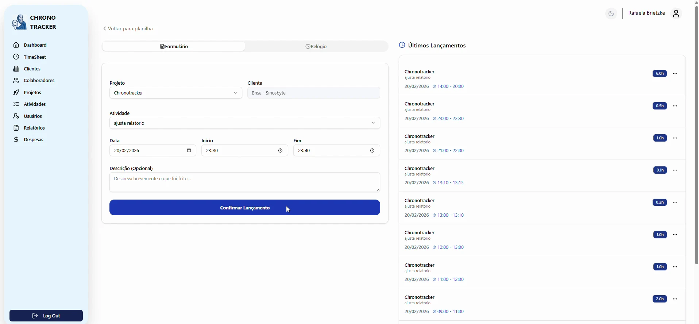
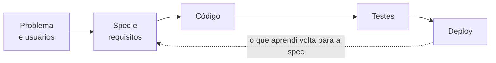

<picture>
  <source media="(prefers-color-scheme: dark)" srcset="assets/banner-dark.svg">
  
</picture>

Fui arquiteta antes de programar. Hoje sou desenvolvedora na **Orpen**, uma plataforma omnichannel: crio APIs e integrações em Node.js (NestJS) e Java (Spring Boot), interfaces em React com TypeScript e levo cada entrega do requisito ao deploy. Estou terminando Análise e Desenvolvimento de Sistemas na Unisinos.

 

## `01` Stack

| | |
| :-- | :-- |
| **Front-end** |  |
| **Back-end** |  |
| **Mobile** |  |
| **Dados** |  &nbsp;+ Oracle |
| **Qualidade** |  &nbsp;+ JUnit · WireMock · BDD |
| **DevOps** |  |
| **IA** | Spec-Driven Development · Claude Code · MCP |
| **Produto** | Requisitos · Scrum (SFC) · Jira · ClickUp · Miro |

 

## `02` Em destaque

### [ChronoTracker](https://github.com/RafaBrietzke/ChronoTracker)

Plataforma SaaS de gestão de projetos e horas, feita para um desafio real da Sinosbyte na Residência em TIC 55. 
**Papel:** líder do projeto e desenvolvimento · **Time:** 5 pessoas · **Resultado:** aprovado na banca final e premiado

<b>Ver o caso em 30 segundos</b>

 

- **Problema:** clientes, cronogramas e horas trabalhadas ficavam em planilhas separadas. Era difícil saber quanto cada projeto já tinha consumido.
- **O que fiz:** conduzi o discovery com a empresa, transformei o pedido em backlog e roadmap de 13 sprints, replanejei depois da banca parcial e coloquei o sistema no ar cedo (Vercel, Render e Neon).
- **Decisões que importaram:** cortar o escopo para o ciclo que gera valor (cadastrar → lançar horas → aprovar → relatório), bloquear lançamentos sobrepostos e mostrar previsto × gasto na própria lista de projetos.

### Plataforma Cultural POA

App mobile que reúne a agenda cultural de Porto Alegre num só lugar. É o meu TCC na Unisinos, com código público a partir de dez/2026. 
**Papel:** idealização, produto e desenvolvimento · **Até agora:** 782 eventos coletados automaticamente desde ago/2026

 

## `03` Como eu trabalho

<b>O que isso quer dizer na prática</b>

 

- **Construo** de ponta a ponta, com testes automatizados e deploy contínuo.
- **Penso produto:** começo pelo problema e por quem vai usar, escrevo requisitos e priorizo.
- **Organizo e entrego:** antes do código, passei quatro anos coordenando de 3 a 4 projetos simultâneos com clientes. Hoje também apoio a organização das sprints do time.
- **Uso IA guiada por especificação:** cada entrega começa por uma spec, não por um prompt.

 

## `04` Contato

&nbsp;&nbsp;

<!-- Quando o portfólio estiver no ar, acrescente na linha acima (troque height por width = largura original x 1,43, igual aos outros):
&nbsp;&nbsp;<a href="https://SEU-DOMINIO"><!-- ajuste width para largura_original × 1,43 -->></a> -->

  

O banner é gerado por <code>scripts/banner.mjs</code> com as cores do meu portfólio.
